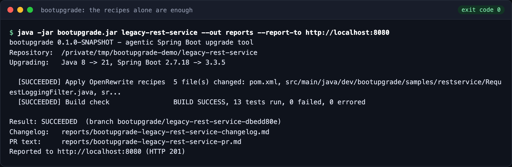
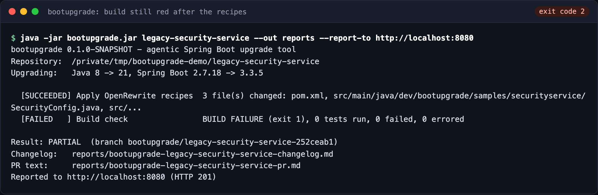
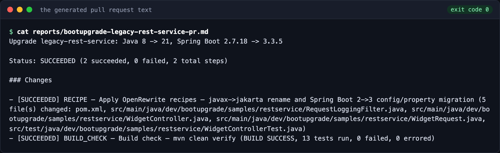
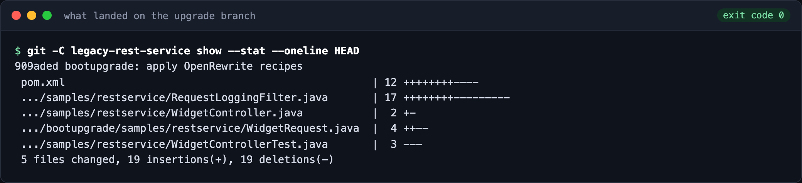
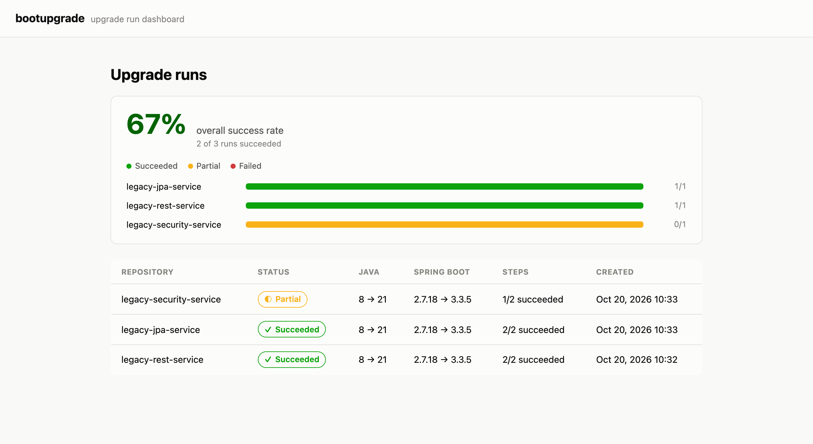
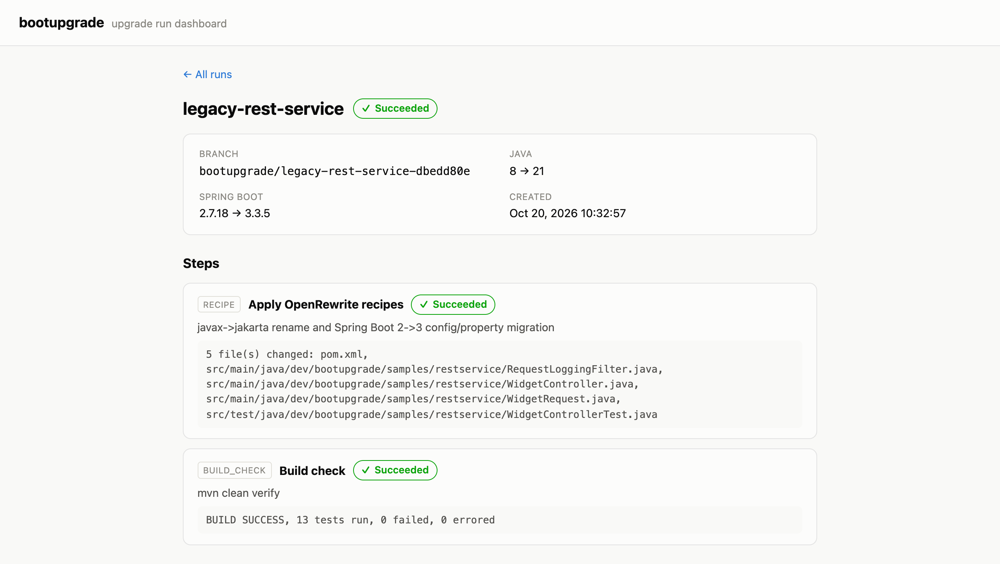
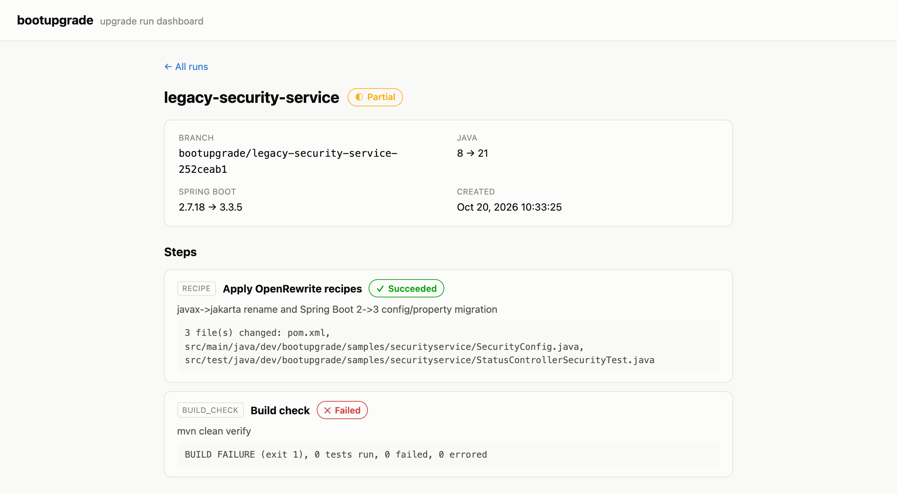
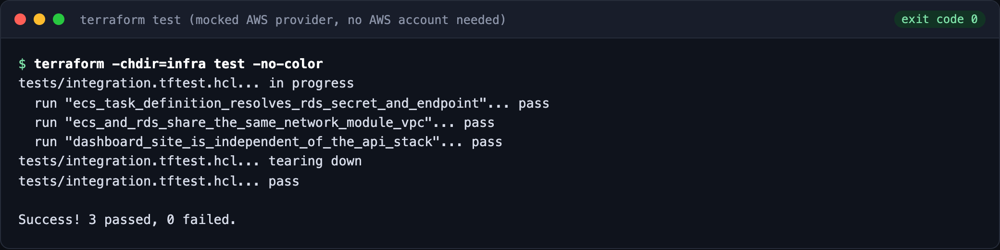

# bootupgrade

[](https://github.com/tenalisriharsha/bootupgrade/actions/workflows/ci.yml)
[](LICENSE)


**Upgrade a legacy Spring Boot 2 / Java 8 Maven project to Spring Boot 3 / Java 21 on a fresh git branch, and get a
changelog and a pull-request description you can paste straight into review.**

bootupgrade runs the [OpenRewrite](https://docs.openrewrite.org/) migration recipes (`javax.*` to `jakarta.*`, Spring
Boot 2 to 3 property and API changes), commits the result, then runs `mvn clean verify` to find out honestly whether the
upgraded project still builds. A dashboard tracks every run and the success rate across your repositories.

## Quick start

You need Java 21 and Maven 3 on your PATH.

```bash
git clone https://github.com/tenalisriharsha/bootupgrade.git
cd bootupgrade/core
mvn -q package -DskipTests          # builds target/bootupgrade.jar

# upgrade one of the bundled legacy sample services (copy it first: the tool commits to the project it is pointed at)
cp -R ../samples/legacy-rest-service /tmp/legacy-rest-service
java -jar target/bootupgrade.jar /tmp/legacy-rest-service --out /tmp/reports
```

That creates a `bootupgrade/<name>-<id>` branch in the project, applies the recipes, commits, builds, and writes
`bootupgrade-<name>-changelog.md` and `bootupgrade-<name>-pr.md` to `--out`. The target repository must have a clean
working tree: if it already has uncommitted changes, the recipe step fails fast rather than folding that pre-existing
work into the upgrade commit.

| Option | Meaning |
|---|---|
| `--out <dir>` | Where the changelog and PR text are written (default: current directory) |
| `--report-to <url>` | POST the finished run to a bootupgrade API so it shows up on the dashboard |

Exit codes: `0` succeeded, `1` bad usage, `2` partial (recipes ran but the build is still red), `3` failed.

## Preview

Every image below is generated by [`scripts/capture`](scripts/capture), which runs the real tool, the real API and the
real dashboard and captures what they print and render. Nothing is mocked up by hand.

**A clean upgrade.** `legacy-rest-service` goes green on the recipes alone, 13 of 13 tests passing on Spring Boot 3:



**An honest partial result.** `legacy-security-service` needs more than the recipes can do, so the run is reported as
`PARTIAL` with exit code 2 instead of claiming success:



**What you get for review.** The generated PR text, and the one commit the recipes made on the upgrade branch (source
and `pom.xml` changes only, never `target/` build output):




**The dashboard.** Every run reported with `--report-to` lands here, with the success rate overall and per repository,
and a step-by-step view of each run:





**The AWS infrastructure is tested without an AWS account.** `terraform test` runs against a mocked provider:



## How it works

```
repository ──> new branch ──> OpenRewrite recipes ──> commit ──> mvn clean verify ──> SUCCEEDED | PARTIAL | FAILED
                                                                        │
                                                       (optional) LLM fix loop ──┘ if the build is red
```

- **`core/recipes`** runs the `rewrite-maven-plugin` with the Spring Boot 3 migration recipe, bumping the parent,
  the Java version and the `javax` imports.
- **`core/git`** uses JGit (no shell `git` needed) to create the branch and commit each step. It keeps `target/` out
  of commits even when the project has no `.gitignore`.
- **`core/build`** shells out to `mvn clean verify` and parses the Surefire results.
- **`core/changelog`** renders the step-by-step changelog and the PR description.
- **`core/agent`** is the optional fallback: an LLM is offered exactly three tools (`read_file`, `write_file`,
  `run_build`) and a fixed iteration budget to repair what the recipes could not. If the budget runs out it reports
  what it tried instead of claiming success.

### What is and is not included

- Included and tested end to end: the recipe, build, git and changelog pipeline, the dashboard and API, and the AWS
  Terraform.
- The LLM fix loop is implemented and tested against a scripted fake client (`FakeLlmClient`), including a case where
  the agent repairs the security sample. **No real LLM provider client is bundled yet**, so the command-line tool
  currently runs recipes and the build only. Adding a provider means implementing the small `LlmClient` interface.
- The Terraform has been validated and tested against a mocked AWS provider. It has never been applied to a real
  account.

## Dashboard and API

```bash
cd api && mvn spring-boot:run          # REST API on :8080 (in-memory H2 by default)
cd dashboard && npm ci && npm start    # dashboard on :4200
java -jar core/target/bootupgrade.jar <project> --report-to http://localhost:8080
```

The API (`api/`) is a Spring Boot 3 service: `POST /api/runs`, `GET /api/runs`, `GET /api/runs/{id}` and
`GET /api/runs/stats/success-rate`. A `prod` profile uses Postgres. The dashboard (`dashboard/`) is an Angular app.

## Deploying to AWS

`infra/` is Terraform for ECS Fargate (the API behind an ALB), RDS Postgres with credentials generated into Secrets
Manager, and S3 plus CloudFront for the dashboard. See [infra/README.md](infra/README.md).

```bash
cd infra
terraform init && terraform validate
terraform test        # 19 checks against a mocked AWS provider; no credentials needed
```

## Repository layout

```
core/        Java 21 library and CLI: recipes, git, build runner, changelog, agent loop
samples/     Three legacy Java 8 / Spring Boot 2 services used as upgrade fixtures
api/         Spring Boot 3 REST API that stores upgrade runs
dashboard/   Angular dashboard
infra/       Terraform for AWS
scripts/     capture/ regenerates the README screenshots
```

## Tests

| Module | Tests |
|---|---|
| `core` | 113 (including real OpenRewrite, Maven and JGit integration tests) |
| `api` | 10 (against a real in-memory database) |
| `dashboard` | 17 (headless Chrome) |
| `samples/*` | 32 |
| `infra` | 19 (Terraform, mocked AWS provider) |

```bash
cd core && mvn test
```

To regenerate the screenshots: `cd scripts/capture && npm install && npm run capture`.

## Project status

Version 0.1. How it was built, phase by phase, is in [PROGRESS.md](PROGRESS.md), and known limitations and ideas
for next steps are in [DAILY_REPORT.md](DAILY_REPORT.md).

## License

[MIT](LICENSE)
